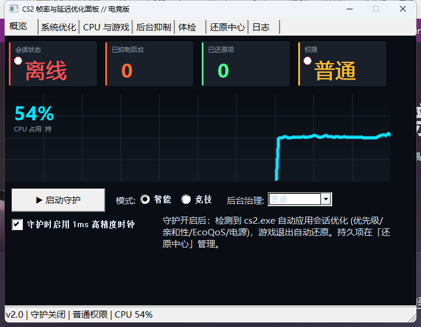
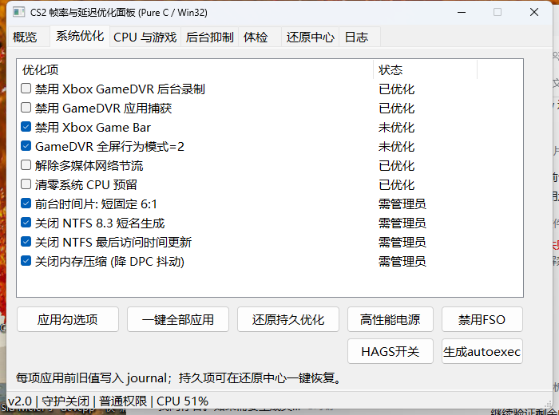
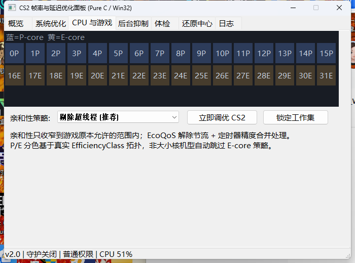

# CS2 帧率与延迟优化面板 // 电竞版

> 纯 C / Win32 打造的电竞级 Counter-Strike 2 系统优化面板  
> **零依赖 · 不注入 · 不碰内存 · 退出自动还原**


---

## 项目简介

**CS2 帧率与延迟优化面板 // 电竞版** 是一款专为 CS2 竞技玩家设计的轻量级 Windows 系统调优工具。通过注册表优化、电源方案切换、CPU 亲和性调整、后台智能抑制等手段提升帧率稳定性，所有改动均通过 **journal 事务日志** 记录旧值，游戏退出或程序崩溃后自动还原。

**设计灵感：** [dulaiduwang003/Pavise-Game](https://github.com/dulaiduwang003/Pavise-Game) —— 会话事务、智能后台抑制、证据分级体检 —— 但用 **纯 C/Win32** 重写（无 .NET、无 Electron，单 exe 仅 92 KB）。

---

## 功能特性

| 模块 | 说明 |
|------|------|
| **会话事务** | 所有持久改动记录到 `journal.txt`；会话项游戏退出自动还原 |
| **崩溃恢复** | 异常退出/断电后，下次启动自动恢复未完成还原 |
| **智能后台抑制** | 只治理有窗口的后台应用；白名单 + 系统关键进程永不触碰 |
| **CPU 拓扑感知** | 真实 P-core/E-core 检测（`GetLogicalProcessorInformationEx`） |
| **电源基线防污染** | 守护启动时采集基线，防止 ProcessLasso/Bitsum 抢先改写 |
| **电竞风格 GUI** | 深空黑底 + 电光青强调 + 发光曲线 + 状态卡片 |
| **7 页标签面板** | 概览 / 系统优化 / CPU 与游戏 / 后台抑制 / 体检 / 还原中心 / 日志 |

---

## 快速开始

### 方式一：下载 Release
从 [Releases](https://github.com/YOURNAME/CS2-Optimizer-Plus/releases) 下载 `CS2_Optimizer_Pro.exe` —— 绿色单文件，无需安装。

### 方式二：源码编译
```bash
# MinGW-w64 GCC
cd src
windres -i app.rc -o app.res -O coff
gcc main.c core.c tweaks.c proc.c checkup.c gui.c app.res -o CS2_Optimizer_Pro.exe -mwindows -municode -lwinmm -ladvapi32 -lgdi32 -luser32 -lshell32 -lcomctl32 -lpsapi -lpowrprof -lshlwapi -O2 -s -Wall
```

或直接双击 `src/build.bat`（自动检测 GCC / MSVC）。

---

## 使用指南

1. **首次运行：** 切换到「体检」页 → 点击 **重新体检** → **一键修复全部** 拉正系统基线。
2. **开启守护：** 概览页点击 **▶ 启动守护** —— 自动检测 `cs2.exe` 并应用会话优化。
3. **亲和性策略：**
   - AMD / 无超线程 → `保持默认`
   - Intel 大小核（12-14 代） → `剔除 E核`
   - 其他 → `剔除超线程`（推荐）
4. **autoexec.cfg：** 生成后务必在 CS2 启动项添加 `+exec autoexec.cfg` —— CS2 不会自动执行。
5. **还原：** 所有改动在「还原中心」可查；持久项需手动还原。

---

## 架构说明

```
src/
  app.h        共享契约 (JournalKind, Settings, CpuTopo, RegTweak, Finding)
  core.c       journal 引擎、双日志、GUID 解析、CPU 拓扑
  tweaks.c     注册表优化、电源方案、FSO、HAGS、autoexec.cfg
  proc.c       进程发现、亲和性/优先级/EcoQoS、后台抑制
  checkup.c    体检采样与分级、一键修复分派
  gui.c        电竞风格 7 页标签面板、自绘控件
  main.c       单实例、守护线程、高精度时钟
  app.rc       清单 (ComCtl32 v6 / asInvoker / PerMonitorV2)
docs/          截图
```

---

## 关键设计决策

### 为什么不用 `EmptyWorkingSet`？
对游戏清空工作集会导致硬缺页和卡顿。我们用 `SetProcessWorkingSetSizeEx` + `QUOTA_LIMITS_HARDWS_MIN_ENABLE` **抬高工作集下限**，而不是清空内存。

### 为什么在守护启动时采集电源基线？
ProcessLasso 等工具会在 cs2.exe 启动瞬间抢先切换方案。如果等到检测到游戏才读「旧值」，记录到的已是对手的值，退出后会还原成错误的方案。

### 为什么用 `EfficiencyClass` 而不是硬编码掩码？
v1.0 用 `effClass >= 0xC0` 判断 P-core —— 在真实硬件上完全错误（实际值只有 0 和 1）。我们通过 SMT 标志 + 效率类交集来判定。

---

## 截图

| 概览 | 系统优化 | CPU 拓扑 |
|:---:|:---:|:---:|
|  |  |  |

---

## 已知限制

- **>64 逻辑核：** 只枚举前 64 核（Group 0）。线程撕裂者 128 核上亲和性回退到「全部核心」。
- **需管理员项：** 部分 HKLM 注册表写入需提权；工具会按需弹 UAC。
- **ProcessLasso 冲突：** 若同时运行，日志会报 `电源方案被外部程序改写` —— 建议在对方软件里排除 cs2.exe。

---

## 开源协议

MIT —— 个人/商用均可，署名非必须但欢迎。

---

## 致谢

- **架构灵感：** [Pavise-Game](https://github.com/dulaiduwang003/Pavise-Game)（会话事务、智能抑制）
- **GUI 主题：** CS2 官方配色（深海军蓝 + 电光青）
- **构建工具：** 纯 C11、Win32 API、MinGW-w64 GCC 14.2
